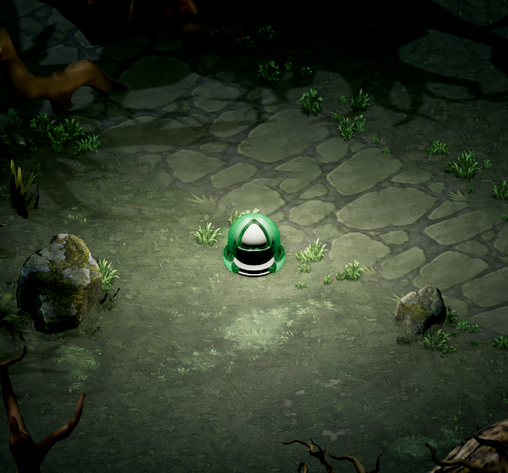
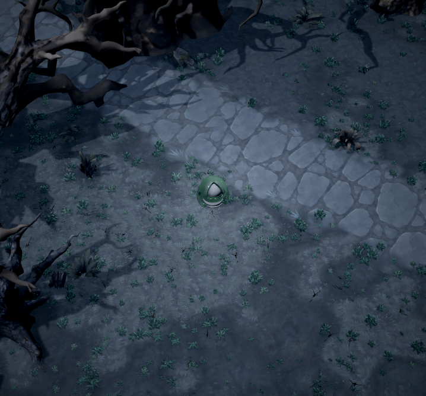
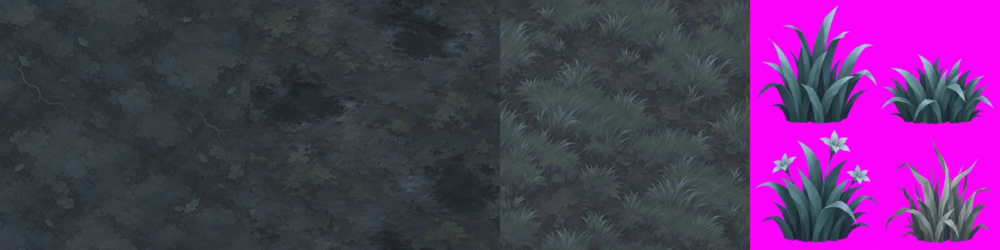

# ASHLAR — Art Direction

**Until the Last · Bản tổng hợp và định hướng sản xuất v1.1 · 20/10/2026**

> **Từ 21/10/2026, bản chuẩn để brief và gen ảnh là [artdirection.md](artdirection.md)** (style đã xác nhận: stylized vừa phải như Diablo Immortal). File này giữ phần lý giải dài; khi hai file khác nhau về cách vẽ, `artdirection.md` thắng.

> **Dark fantasy vẽ tay, hình khối rõ, bề mặt tiết chế. Một thế giới được giữ lại bằng những mối nối không hoàn hảo, nơi vẻ đẹp hoàn mỹ dần trở thành lời đe dọa.**

Diablo Immortal là tham chiếu chính về **style và khả năng đọc** trong gameplay: cách tổ chức hình ảnh, khối, mật độ chi tiết. Immortal không phải preset mood cho toàn game. Bản sắc kể chuyện, chất liệu, nghề nghiệp, quái vật và biểu tượng thuộc về ASHLAR.

**Style chung và mood từng map là hai lớp khác nhau.** Theo quyết định mới nhất của người dùng: mood thay đổi theo map; Map 1 lấy mood Act I Diablo II (diễn ý, không phải trích nguyên văn).

- **Style chung toàn ASHLAR:** painterly/stylized ít chi tiết, khối rõ, mật độ nét và mảng theo bộ `stylized2`, khả năng đọc theo tinh thần Immortal.
- **Mood riêng từng map:** palette, ánh sáng, thời tiết, sương, tương phản và nhịp cảm xúc. Mỗi map có mood riêng. **Map 1 hướng tới mood Act I Diablo II** (xem §7.1).

Mood Dark Wood v1 (ánh trăng xanh lạnh) trước đây chỉ là mood riêng của scene thử Immortal và là mẫu lịch sử; nó không phải mood mặc định của ASHLAR hay Map 1.

Tài liệu này dùng để brief concept, character, environment, animation, VFX và lighting. Đây là **art direction v1 được đề xuất trên nền các quyết định đã chốt**, không phải tuyên bố rằng mọi quy tắc mới đã được người dùng duyệt hoặc đã được triển khai trong game.

### Bộ tài liệu đi kèm (dẫn đọc)

Bản v1.1 mở rộng sang biome, khu vực, quái, kích thước, màu key, silhouette và mood/feel/hành vi. File này là **master art direction**; chi tiết nằm ở bốn file kề bên. Muốn biết thế giới có những môi trường nào thì đọc §16 trước, rồi sang file tương ứng.

| Cần biết | Đọc | Trạng thái |
|---|---|---|
| Nguyên tắc chung, style, mood Map 1, brief, cổng duyệt | File này (§1–§15) | Đề xuất AD v1 (bản v1.1) |
| Tổng quan vùng → biome → area → quái | File này, **§16** | Tóm tắt, không thay hai file chi tiết |
| 27 nhóm biome, 50 area, mood theo map, hub | [Biome và khu vực](ASHLAR_BIOME_VA_KHU_VUC_VI.md) | Tổng hợp nguồn; biome là đề xuất, chưa duyệt |
| Quy chuẩn từng ID quái: kích thước, màu key, silhouette, feel, hành vi canon | [Quy chuẩn quái](ASHLAR_QUY_CHUAN_QUAI_VI.md) | Đề xuất sản xuất; chưa duyệt |
| 116 ID quái và cột duyệt ✓ | [Checklist quái](ASHLAR_MONSTER_CHECKLIST_VI.md) | Danh sách gốc; không bị file trên thay thế |
| Hình tham khảo mood/style | [Bảng tham chiếu hình ảnh](ASHLAR_ART_DIRECTION_BOARD.html) | Đi kèm file này |

Hai file chi tiết (biome, quy chuẩn quái) đang trong vòng review. Master chỉ dẫn tới chúng và tóm tắt cấu trúc; **không sao chép** số đo, dải chiều cao hay bảng màu của chúng. Chỉ khi hai file được duyệt mới cân nhắc đưa con số vào đây.

## 1. Cơ sở và thứ tự ưu tiên

### Những gì đã chốt

- **Thế giới:** ASHLAR, theo quyết định trong thread phân tích tài liệu thiết kế.
- **Style terrain chung:** painterly/stylized, ít chi tiết, mảng lớn; bộ `art/terrain-dark-wood/stylized2/` là chuẩn mật độ nét và mảng. Chuẩn này là **style**, không ràng buộc màu hay mood.
- **Mood theo từng map:** mood tuỳ map; người dùng đính chính rằng không có một mood chung cho cả game.
- **Map 1 → mood Act I Diablo II:** quyết định mới, ưu tiên hơn các diễn đạt trước về mood. Phạm vi "Map 1" chưa được xác nhận chi tiết; **không tự đồng nhất** với toàn bộ Act I hay với Prologue ASHLAR.
- **Dark Wood v1 (`webgl_stylized_v1.png`):** mood riêng của scene thử Immortal (ánh trăng xanh lạnh) và mẫu style lịch sử. Không phải mood mặc định của ASHLAR hay Map 1; không cam kết giữ vị trí cây/cỏ hay thông số nào cho cả game.
- **Đường đá:** trở lại bản viên lớn của `stylized2`. Bản đá nhỏ `stylized3` bị loại vì lốm đốm trong scene.
- **Biến thể xanh:** `stylized2_green` cùng scene `darkWoodD2` là **điểm xuất phát lookdev của Map 1**, không phải Map 1 đã dựng hay nghiệm thu.
- **Roster concept quái đợt đầu:** người dùng chốt **25 quái thường** (U01–U05, D01–D04, W01–W07, F01–F02, P01–P07) và **5 boss** (B01–B05). Cả 30 ID đều có trong checklist. Đây là **roster concept**, không phải ranh giới runtime của Map 1, và không đồng nhất Map 1 với toàn bộ Prologue hay Act I. W01 và D01–D04 còn xuất hiện ở act sau (W01 ở II; D01–D02 ở III/IV, D03 ở IV, D04 ở mọi act), nên concept đợt này là **biến thể Prologue/Act I** của các quái đó.

### Cách đọc nguồn

| Nhãn | Ý nghĩa |
|---|---|
| **Đã chốt** | Quyết định trực tiếp của người dùng trong hai thread. |
| **Canon** | Nền tảng thế giới trong World Bible; Cast cụ thể hóa nhân vật và quái. |
| **LD** | Hướng dẫn Level Design and Atmosphere. Các mục tự ghi *Proposal* vẫn là đề xuất. |
| **Tham chiếu Immortal** | Kết quả research của thread trước; phân biệt lời dev, quan sát ảnh và điều chưa xác minh. |
| **Đề xuất AD v1** | Quy tắc sản xuất cụ thể hóa trong tài liệu này. Chưa phải canon hoặc quyết định cũ của người dùng. |

Khi có xung đột: quyết định mới nhất của người dùng (kể cả đính chính mood theo từng map) → World Bible về canon → Cast và LD trong phạm vi tương ứng → đề xuất của tài liệu này. Art bible D2 trong `../art-direction/` là nguồn tham khảo, không tự động phủ quyết lựa chọn ASHLAR. Mâu thuẫn nội bộ canon được ghi lại để xử lý, không tự sửa bằng một quyết định mỹ thuật.

## 2. Tổng hợp bài học từ Diablo Immortal

**Giữ khả năng đọc ở kích thước gameplay.** Thread tham chiếu dẫn phỏng vấn Hunter Schulz: Immortal cần hình khối và màu mạnh để dễ đọc, thậm chí yêu cầu cao hơn D3. Áp dụng cho ASHLAR bằng đường bao rõ, phân nhóm sáng tối và điểm nhấn có chủ đích; không hiểu thành làm mọi vật nhiều màu hoặc phát sáng.

**Thiết kế class đi cùng hành vi.** Ví dụ Tempest cho thấy hình khối, vũ khí và cách di chuyển cùng truyền đạt nước/gió. ASHLAR cần cùng mức nhất quán giữa nghề, đạo cụ, tư thế, đòn đánh và vật liệu.

**Giữ căn tính cơ thể qua trang bị.** Blizzard mô tả giáp thường của Immortal phù hợp giải phẫu, cosmetic có thể phá khuôn. Điều này không có nghĩa đường bao hoàn toàn bất biến, hoặc cấp đồ chỉ được biểu đạt bằng VFX. Đề xuất cho ASHLAR: giáp mới thay đổi hình dáng nhưng vẫn giữ tư thế, khối chính và đạo cụ nhận diện nghề.

**Tổ chức bề mặt như tranh.** D3 và ảnh gameplay Immortal gợi cách dùng khối lớn, cạnh sáng chọn lọc, chi tiết gom vào điểm nhìn. Đây là phân tích thị giác, không phải xác nhận pipeline shader hay cách Blizzard làm mọi texture. Quyết định giảm detail của người dùng là căn cứ trực tiếp mạnh hơn mọi suy đoán về pipeline.

**Tách mỹ thuật gameplay khỏi cosmetic trình diễn.** ASHLAR lấy khả năng đọc, nhịp sáng tối và tổ chức vật liệu làm chuẩn. Vầng sáng dày, cánh khổng lồ hoặc giáp đầy hiệu ứng không trở thành yêu cầu mặc định cho trang bị cao cấp.

Các nhận xét “nửa trên luôn đậm hơn nửa dưới”, “boss cao gấp 3–4 lần hero” và bảng màu elite trong thread trước **không phải luật sản xuất đã được xác minh cho toàn bộ Immortal**. Không nhập chúng thành giới hạn cứng của ASHLAR. Việc Immortal hướng đến mobile cũng không xác định nền tảng phát hành của ASHLAR.

## 3. Năm trụ cột hình ảnh

1. **Đọc được trước khi trang trí.** Đường bao → khối sáng tối → điểm màu → vật liệu → chi tiết. Trong giao tranh, tín hiệu gây hại phải giữ được hình dạng và thời điểm đọc.
2. **Nền yên, chủ thể có trọng lượng.** Mặt đất ít chi tiết và ít tương phản cục bộ. Nhân vật và quái được tách bằng khối, tư thế, chuyển động và độ sáng phù hợp với nền.
3. **Đường may là sự sống.** Vết vá, mối nối, đinh, dây buộc và chỗ sửa chữa biểu đạt sự chăm sóc của con người. Gần Perfection, các dấu ấy bị xóa và trật tự trở nên đáng sợ.
4. **Ánh sáng có nguồn gốc.** Ánh sáng phải thuộc về một tác nhân trong thế giới. Màu ấm không luôn đồng nghĩa an toàn; ánh sáng đẹp có thể là cám dỗ.
5. **Kinh dị đến từ sự sai lệch có nghĩa.** Một xác chết vẫn làm nghi thức, vải liệm chăm sóc quá mức, một cơ thể bằng đất nung nứt men: hình ảnh bất an phải kể được điều gì đã xảy ra.

“Ít chi tiết” không đồng nghĩa làm mờ mọi thứ. Cạnh mang thông tin phải rõ; vùng không mang thông tin được giản lược. “Tối” không đồng nghĩa nghiền toàn bộ bóng thành đen, và “painterly” không đồng nghĩa viền đen hoạt hình quanh mọi vật.

## 4. Chuẩn style và mẫu hình ảnh

*Map 1 · mục tiêu mood Act I Diablo II. Ảnh là scene thử `darkWoodD2` trong lab, chỉ để tham khảo hướng; **chưa phải hình Map 1 hoàn tất hay đã duyệt**. Nhân vật tròn xanh là placeholder, không phải mẫu tạo hình hero; cảnh cũng chưa phải bài kiểm tra combat đầy đủ.*

*Dark Wood v1: mood riêng của scene thử Immortal (ánh trăng xanh lạnh) và mẫu style lịch sử. Không phải mood mặc định của ASHLAR hay Map 1.*

*Chuẩn cách vẽ và mật độ chi tiết: đất, bùn, cỏ và thẻ cỏ. Màu trong ảnh không phải màu hay mood bắt buộc. Nền magenta của thẻ cỏ là nền phục vụ tách ảnh, không thuộc bảng màu game.*

| Mẫu | Vai trò trong sản xuất |
|---|---|
| `stylized2/` | **Chuẩn style:** mật độ chi tiết, nét cọ và quy mô mảng của terrain; màu gốc xanh lam xám là mood của scene thử Immortal, không bắt buộc. |
| `stylized2_green/` | Recolor xanh lá trên cùng cấu trúc vẽ; cùng scene `darkWoodD2` là **điểm xuất phát lookdev của Map 1** (mood Act I Diablo II), chưa phải Map 1 hoàn tất. |
| `stylized/` | Mẫu đối chiếu bị loại: còn quá nhiều chi tiết. |
| `stylized3/path_cobble.png` | Mẫu đối chiếu bị loại: đá nhỏ làm đường lốm đốm. |
| Bộ realistic ngoài `ashlar/` | Tài liệu so sánh, không phải chuẩn bề mặt ASHLAR. |

**Đề xuất AD v1:** giữ chất mảng và mức độ tiết chế của `stylized2` (style chung) xuyên suốt các map; thay đổi vật liệu, khí hậu, màu và mood theo từng map. Không phủ cùng một mood hay màu, kể cả xanh lạnh Dark Wood hay xanh Act I D2, lên toàn bộ thế giới.

## 5. Ngữ pháp hình khối, vật liệu và ánh sáng

Bảng sau kế thừa LD §4.1. Phần hành vi chuyển động ánh sáng dùng Proposal ở LD §5.1 làm **đề xuất áp dụng cho AD v1**, không đổi trạng thái của nó thành canon đã duyệt.

| Nguồn gốc | Hình khối và bề mặt | Ánh sáng / chuyển động đề xuất | Dấu hiệu phải giữ khi giản lược |
|---|---|---|---|
| **Con người / The Moss** | Lệch nhẹ, chắp nối; gỗ, đá lửa, len, dây, sáp; đồ vật được sửa nhiều lần. | Nguồn nhỏ, ấm, không đều; lập lòe và có khói. | Một mối nối hoặc chỗ vá đủ lớn để thấy ở camera chơi. |
| **Masons** | Góc vuông, thẳng đứng, hàng đá chính xác; đá xám có dấu đục, công cụ sắt; quy mô hơi quá lớn. | Không tự phát sáng; nhận sáng từ bên ngoài. | Hình học đo đạc và tỷ lệ áp chế. Chính xác không đồng nghĩa bóng loáng hoặc không có dấu dụng cụ. |
| **Perfections** | Đối xứng, lặp lại, đường cong liền mạch; vật liệu gắn với từng Perfection. | Đều, đẹp, đứng yên; nguồn sáng giống nhau đến bất thường. | Thiếu vết vá, hao mòn và sai khác của bàn tay con người. |
| **Discarded** | Thấp, chắc, sừng/móc; đất nung, men, xỉ; dấu nặn, vết nứt lò. | Lửa đỏ cam từ trong khe nứt, phập phồng như bễ. | Cảm giác đồ vật được nung và bị vứt bỏ; công cụ xây dựng. |
| **The Wall** | Hàng xương và sọ, bàn tay nắm nhau trong vữa xám; bề mặt ẩm, có lịch sử. | Điểm trắng lạnh hoặc ánh rỉ qua khe. | Cấu trúc xây bằng người; chọn cụm xương có nghĩa thay vì phủ noise đầu lâu. |

Không trộn Mason với Seamless: Mason còn khối đá, mạch xây, vết đo/đục; Seamless xóa hoàn toàn mối nối và bề mặt. Đây là hai kiểu đáng sợ khác nhau.

### Cách diễn đạt vật liệu — đề xuất AD v1

- **Đá:** khối phẳng lớn, cạnh vỡ chọn lọc; rêu gom vào vùng, không phủ đốm đều.
- **Gỗ:** thớ thành dải rộng, mối ghép và đầu gỗ rõ; tránh hàng trăm rãnh nhỏ.
- **Vải:** nếp gấp lớn theo trọng lực, đường may có chức năng; vải Mercy sạch và liền mạch hơn vải người.
- **Kim loại:** phản sáng theo mặt và cạnh quan trọng; giữ khoảng tối giữa các mảng. Không viền sáng mọi cạnh hoặc cho toàn bộ giáp bóng như nhựa.
- **Xương:** màu ngà/xám và hình dáng bất cân; giữ cấu trúc lớn trước các vết nứt.
- **Đất nung:** thân tương đối mờ, men khác độ nhám theo mảng, vết nứt có chiều sâu; chỉ phát sáng khi đúng nguồn gốc.
- **Muối, kính và băng:** phân biệt bằng độ đục, cạnh, khối và cách nhận sáng; không dùng chung một shader bóng xanh cho cả ba.

## 6. Terrain, cây cỏ và kiến trúc

### Terrain

`stylized2` là mức chi tiết tham chiếu. Đất dùng vài mảng rộng; rễ và lá là nét phụ. Bùn có chuyển sắc mềm và phản sáng tiết chế. Cỏ đọc thành cụm lá, không thành nhiễu hạt. Đường đá vẫn có nhịp khối lớn; tránh viền trắng bao từng viên.

**Đề xuất AD v1:** giữ vùng di chuyển và combat có bề mặt yên; đưa chi tiết vào bờ đường, chân tường và điểm kể chuyện. Nếu đường đá bị quá to, thử thay đổi bố cục và tỷ lệ trong scene trước khi tăng số viên nhỏ. Mẫu `stylized3` cho thấy tăng detail có thể làm khả năng đọc kém đi.

Tile phải chịu được lát lặp: tránh vũng sáng, rễ hình đặc biệt hoặc cụm cỏ đặt đều gây lưới. Duyệt cả ảnh lặp 2×2/3×3 và ảnh ở khoảng cách chơi; texture đẹp khi mở riêng chưa đủ.

### Cây cỏ và bố cục

- Gom cỏ thành cụm lớn–vừa–nhỏ bất đều, có khoảng đất trống giữa các cụm.
- Cây lớn tạo khung và chiều sâu; cành tiền cảnh không che vùng ra đòn hay đường thoát.
- Dùng hình thân cây, tán và độ dày cụm để phân biệt biome. Đổi màu một bộ cây chưa đủ tạo vùng mới.
- Đá rêu và bụi cỏ không tự thành điểm sáng nhất nếu không mang thông tin gameplay.

### Kiến trúc

Đọc công trình theo **khối lớn → cửa/vòm → hệ chống đỡ → vật liệu → dấu sử dụng**. Vòm, bàn tay, tường xương, công cụ thợ xây và chỗ vá là motif riêng của ASHLAR. Mỗi địa điểm chọn motif phù hợp câu chuyện; không gắn mọi biểu tượng lên mọi asset.

Con người dựng thêm và sửa lại; Perfection phủ lớp trật tự lên công trình cũ. Sự biến đổi cần nhìn thấy theo tuyến đi: vết vá thưa dần, mối nối biến mất, nguồn sáng đều hơn. Một khu không cần thêm quái để bắt đầu gây bất an.

### Texture và normal map

Pipeline lab hiện có tạo normal từ height đã xử lý mềm; README ghi `--stylized` giảm bump để nét cọ không thành nhiễu. Giữ nguyên tắc đó: normal mô tả khối vật liệu, không biến mọi chênh lệch màu thành lồi lõm. Màu vẽ không phải lúc nào cũng tương ứng độ cao vật lý.

Kiểm tra seam, hướng normal và độ mạnh dưới nhiều hướng sáng. Albedo giữ chất tranh nhưng tránh bake bóng đổ mạnh theo một hướng làm xung đột với đèn di động. Không dùng roughness để tạo một mảng sáng che telegraph trên bùn.

## 7. Màu, value và mood theo hành trình

**Value trước hue.** Nền, chủ thể và dấu hiệu gameplay phải tách được khi bỏ màu. Trong vùng tối, có thể nâng khối sáng chủ thể trên nền; ở vùng muối sáng, dùng khối tối và viền tương phản thích hợp. Không áp quy tắc “hero luôn sáng hơn nền” cho mọi act.

**Mood theo từng map, không theo một preset toàn game.** Bảng color script bên dưới theo act là **khung lore gợi ý** (LD §5.4), không phải mood bắt buộc của mọi map trong act ấy. Mỗi map có mood riêng; mood của Map 1 (§7.1) không lan sang target của các act khác.

Các mã dưới đây là **swatch khởi điểm của LD §5.4**, không phải màu đo từ ảnh Dark Wood hay `darkWoodD2`, màu cuối của pixel trong game hay mục tiêu phơi sáng. Màu albedo, màu nguồn sáng và kết quả sau tone mapping là ba việc khác nhau. Tài liệu này không nhập các dải số value của bible D2 thành chuẩn cứng của ASHLAR.

| Chặng | Màu / vật liệu nền từ LD | Điểm nhấn | Chuyển biến cảm xúc và hình ảnh |
|---|---|---|---|
| **Prologue** | Đá, xương, vữa trong tối; LD dùng palette Act I về đêm. | Ánh đèn của Gennet mở ra hơi ấm đầu tiên. | Chật, nặng, chưa biết ai đang nhìn. LD §10 ghi Prologue dùng palette Act I về đêm, không có accent. |
| **I · Dolmoor / Mercy** | Xanh xám `#5E6B5A`, đen đầm `#1F2A24`, than bùn `#4A3526`; sương. | Đỏ poppy `#B3262A`; hổ phách nến `#E0A050`. | Từ vùng ẩm, có dấu vá sang vải lanh sạch, giấc ngủ và sự chăm sóc đáng sợ. Đây là khung lore gợi ý cho Dolmoor/Mercy, **không** quy định mood Map 1 (§7.1) và không bị mood Dark Wood v1 hay bản xanh áp đặt; mood từng map ở vùng này được quyết định riêng. |
| **II · Sepulcra / Devotion** | Đen muội `#17151A`, xương `#E6DFCF`; thành phố đứng cao, chật. | Cam giàn thiêu `#E2622B`, vàng nến `#D9A441`. | Hành hương trở thành cưỡng ép; nhịp thẳng đứng, chuông, sắt và đoàn người. |
| **III · Blanched Sea / Purity** | Muối/xương `#EDEAE0`, trời sữa `#DCE3E6`, nước muối `#3F8C88`, gỉ `#8A4B2D`. | Máu đỏ `#9E1B1B`; màu được giữ kín trong Undercity. | Kinh dị giữa ánh sáng. Trắng mờ, có bụi và bề mặt; tuyệt đối không dùng như trắng phát sáng Seamless. |
| **IV · Hoarfast / Memory** | Băng xanh đen `#14202E`, xanh sương `#6F8FA8`. | Hổ phách `#E5A44C`, màu trang sức cũ: garnet, emerald, old gold. | Ấm áp nhìn từ xa, sự sống bị giữ đứng yên khi lại gần. Tuyết đổi màu theo bóng lạnh và đèn ấm. |
| **V · Lanternshore / Hope** | Slate `#3B4650`, xanh biển `#2F5A52`, đá ướt `#121417`. | Đèn vàng `#F2C14E`, ngọn trắng `#F8F6EE`. | Đèn hứa hẹn đoàn tụ rồi trở thành hiểm họa; khoảng trống, bờ biển và đợi chờ. |
| **The Course** | Ochre `#A57F45`, xương `#D8CCB0`, xám ấm `#8C847A`. | Ánh trắng qua khe; ngoại lệ lửa lò khi Spoil xuyên vào. | Vật liệu mang màu ấm không có nghĩa được chiếu đèn ấm. Người chơi thấy cấu trúc thật của nhà ngục. |
| **The Seamless** | Trắng ánh sáng, vàng `#F4D58D`, trời xanh hoàn hảo `#8EC9F0`. | Tương phản của hero và thông tin trận đánh. | Không seam, không wear, không texture; vẻ hoàn hảo trống rỗng. Bloom là ngoại lệ kể chuyện có chủ đích. |

**Đề xuất AD v1:** một điểm nhấn môi trường chủ đạo trong mỗi bố cục, với ngoại lệ có nghĩa trong LD. Không ép mọi hiệu ứng, mọi class và mọi quái cùng dùng một hue. Màu nhận diện phải được thử trên cả nền tối và nền trắng; màu lore không thay thế dấu hiệu gameplay.

Ánh sáng của Perfection có thể ấm và đẹp. Vì vậy, “ấm thật” với “ấm giả” cần khác về nhịp, sự không đều, khói và ngữ cảnh. Bài duyệt lighting phải có clip chuyển động, không chỉ screenshot.

### 7.1 Map 1 — mood Act I Diablo II

**Trạng thái:** quyết định của người dùng về hướng mood; phần mô tả bên dưới là **đề xuất triển khai AD v1**, chưa phải thông số đã duyệt hay đã dựng. "Map 1" chưa được đồng nhất với toàn bộ Act I hay Prologue ASHLAR; các chi tiết map (bố cục, địa điểm, cốt truyện) chưa xác nhận.

- **Không khí:** đồng hoang/rừng ẩm lạnh, hoang vắng, hơi bất an nhưng vẫn đi được.
- **Màu:** xanh cỏ sẫm/ôliu; đất nâu bùn; đá xám cũ. Điểm ấm nhỏ ở nơi có con người (lửa, đèn, mái), theo nguyên tắc nguồn sáng của §5.
- **Ánh sáng:** u ám, tiết chế; bóng sâu nhưng vùng di chuyển và combat vẫn đọc được theo value (§3, §13).
- **Style:** giữ texture painterly ít detail theo `stylized2`; mood D2 là về màu/ánh sáng/không khí, không đưa lại độ chi tiết kiểu ảnh thực.
- **Điểm xuất phát lookdev:** `stylized2_green` + scene `darkWoodD2` (README bộ terrain). Là nền thử, không phải Map 1 đã dựng; mọi tham số của scene vẫn là của scene thử.
- **Chưa khóa:** giờ trong ngày, góc camera, budget, màu số cụ thể, và chi tiết map. Duyệt bằng cảnh có hero, quái, telegraph và loot trong camera chơi, kèm clip chuyển động.

### 7.2 Mẫu trường mood cho mỗi map

Mỗi map có thẻ mood ngắn, điền trước khi lookdev:

| Trường | Nội dung |
|---|---|
| Map / vùng | Tên hoặc ID map; ghi rõ không suy ra từ act. |
| Mood mục tiêu | Một câu cảm xúc + tham chiếu (nếu có). |
| Palette | Nền / điểm ấm / accent; swatch chỉ là điểm xuất phát. |
| Lighting & thời tiết | Nguồn sáng chính, sương, mưa/gió; giờ trong ngày chỉ ghi khi đã xác nhận. |
| Tương phản & value | Mức tương phản, cách tách hero–địch–nền. |
| Nhịp cảm xúc | Diễn biến theo tuyến đi. |
| Style kế thừa | `stylized2` hoặc ghi rõ ngoại lệ. |
| Trạng thái | Đề xuất / đang lookdev / đã duyệt; ngày và người duyệt. |
| Chưa khóa | Camera, budget, chi tiết map còn mở. |

## 8. Hero và sáu nghề

Canon của Cast §8.3: nghề thuộc về người chết mà hero nắm tay khi rơi khỏi Tường. Mỗi nghề có đạo cụ và cách dùng quyền năng gắn với thế giới ASHLAR.

**Đề xuất AD v1 cho mọi nghề:** một khối nhận diện chính, một đạo cụ đặc trưng, một nhịp chuyển động. Gom chi tiết vào đầu–thân trên–tay–vũ khí khi các vùng ấy thực sự đọc tốt từ camera chơi; chân vẫn phải rõ tư thế và nhịp bước. Không áp mệnh lệnh làm tối chân một cách máy móc.

| Nghề | Căn tính từ Cast | Đề xuất hình dáng và chuyển động | Điều cần tránh |
|---|---|---|---|
| **Pallbearer** | Hiệp sĩ nặng; khiên nắp quan tài; sức mạnh liên quan gánh nặng. | Khối vững, trọng tâm thấp; nắp quan tài đọc được trong silhouette; bước và đòn thể hiện tải trọng. | Chỉ dùng vai khổng lồ để tạo cảm giác nặng; che mất hình quan tài bằng trang trí. |
| **Flagellant** | Võ sĩ cận chiến biến vết thương thành sức mạnh. | Khối cơ thể linh hoạt, nhịp co–duỗi rõ; băng, dây và dấu chịu đựng thành mảng. | Lấy gore chi chít thay cho tư thế và đòn đánh; chi tiết máu nhỏ không đọc được. |
| **Ossuarist** | Mượn linh hồn từ Tường; quá mức có thể làm Tường nứt. | Dáng và đạo cụ mang tính nghi lễ; cụm xương, vữa và linh hồn gắn với thao tác cụ thể. | Thành necromancer chung chung với mọi thứ xanh phát sáng và đầu lâu khắp người. |
| **Brinecaller** | Muối và thủy triều: kết tinh, bào mòn, nhấn chìm. | Khối muối sắc đối thoại với chuyển động nước cong; chất trắng đục, teal và cặn khoáng có kiểm soát. | Trùng toàn bộ hình dáng, vật liệu và phép với pháp sư băng. |
| **Exhumer** | Thợ săn tầm xa, bẫy; tự điều khiển light radius. | Áo dầu, đèn che sáng, công cụ dài/nỏ theo thiết kế nghề; dáng tiến–rút cảnh giác. | Ánh sáng trang trí thường trực khiến cơ chế sáng/tối mất ý nghĩa; lẫn với tuần tra Exhumer đối địch. |
| **Pyre-Singer** | Phép là bài hát; lửa cho người chết, băng cho người sống. | Nhịp lấy hơi, mở thân và kết câu rõ; lửa/băng chung một ngôn ngữ nghi lễ. | Hai bộ hiệu ứng rời rạc; biến mọi động tác thành vung trượng giống Brinecaller. |

Trang bị tiến triển bằng cấu trúc, vật liệu, kỹ nghệ, dấu lịch sử và điểm nhấn có nghĩa. Tăng cấp không bắt buộc tăng glow, cánh, sừng hoặc mật độ chi tiết. Đạo cụ nhận diện nghề vẫn phải đọc ở các cấp đồ khác nhau.

Hero, đồng đội và người cùng nghề đối địch cần tách bằng hành vi, dấu mục tiêu và bố trí mảng; màu áo riêng lẻ không đủ. Bảng màu cuối cho từng nghề cần concept trong scene trước khi khóa.

## 9. Quái vật, elite và boss

[Checklist hiện có](ASHLAR_MONSTER_CHECKLIST_VI.md) ghi **99 loại quái thường và 17 boss**, không phải 116 concept đã duyệt. ID trong checklist là khóa dùng cho brief và phản hồi art. Quy chuẩn chi tiết theo từng ID (kích thước, màu key, silhouette, feel, hành vi canon) nằm ở [Quy chuẩn quái](ASHLAR_QUY_CHUAN_QUAI_VI.md); tóm tắt cách đọc ở §16.3.

Cast §12 yêu cầu giữ nhóm silhouette, vai trò combat và hành vi đặc trưng của tham chiếu; đổi tên, nguồn gốc, vật liệu, palette và một dấu hiệu chỉ ASHLAR mới có. Điều này giữ archetype gameplay quen thuộc, không phải sao chép nguyên đường bao hay trang phục cụ thể của Diablo. Boss ASHLAR có thiết kế riêng.

### Họ quái

| Họ | Cơ sở thiết kế từ Cast/checklist | Đề xuất quy tắc đọc ở khoảng cách chơi |
|---|---|---|
| **Unlaid** | Người chết không yên; cách chết và nghi thức chôn còn trên cơ thể. | Tư thế là dấu đầu tiên: gục, lệch xương, phình, cõng quan tài. Vải liệm và đồ tùy táng thành mảng. |
| **Discarded** | Lao động đất nung bị Masons bỏ đi; sừng, men, công cụ. | Sừng/móc và dáng nghề phân vai; khe lò là accent, không phủ toàn thân bằng lửa. |
| **Warped** | Sinh vật biến đổi; roster hiện còn trường hợp người, lửa và rễ cây cần phân loại. | Giữ một nền sinh học dễ nhận rồi làm sai một đặc trưng chính. Không buộc mọi mục thành thú bốn chân. |
| **Faithful** | Người, giáo phái, binh lính và các trường hợp còn tranh chấp phân họ. | Nhận ra nghề/nghi thức trước: quỳ, mang chuông, mang đèn, đeo vòng sắt. Giữ nét người đủ để sự biến đổi gây bất an. |
| **Perfection-born** | Mercy, Devotion, Purity, Memory, Hope tạo ra quái theo bản chất riêng. | Nhận diện bằng vật liệu và hành vi: vải/bàn tay; sắt/chuông; muối/kính; vật lưu giữ; đèn/mồi nhử. |
| **Lodge's servants** | Tượng và cấu trúc phục vụ Masons. | Trọng lượng đá, hình học đo đạc, chuyển động có nhịp dụng cụ; không glow tùy tiện. |
| **The Perfect** | Sự hoàn hảo cuối cùng trong roster. | Phân biệt bằng thiếu hụt chi tiết, bề mặt và chuyển động bất thường; tránh bù sự trống bằng hoa văn dày. |

Một thiết kế phải trả lời được **họ nào, đánh kiểu gì, nguy hiểm lúc nào**. Thêm chi tiết chỉ khi nó giúp một trong ba câu hỏi ấy.

### Vai trò và cấp nguy hiểm — đề xuất AD v1

- **Quái bầy nhỏ:** silhouette gọn, nhịp chuyển động tập thể rõ; chi tiết ít nhất trong nhóm.
- **Quái nặng:** khối chịu lực, vũ khí và chuẩn bị đòn tạo cảm giác sức nặng; tăng kích thước có chọn lọc.
- **Quái tầm xa/caster:** tư thế và đạo cụ chỉ hướng, nhịp chuẩn bị dễ nhận; không lẫn động tác idle với wind-up.
- **Elite:** giữ nhận diện loài; thêm dấu cấp độ ổn định bằng biểu tượng/khung mục tiêu và một accent tiết chế. Màu elite cụ thể chưa khóa; phải đối chiếu palette act và màu loot.
- **Boss:** một ý tưởng chủ đạo đủ mạnh ở thumbnail, một đặc trưng chuyển động, silhouette và arena phối hợp. Kích thước theo cơ chế và camera; không mặc định mọi boss cao gấp một con số cố định so với hero.

Ví dụ brief **Hodling**: hình nhỏ, sừng ngắn và công cụ đọc được; đất nung đỏ có mảng men nứt lớn; lửa bên trong chỉ xuất hiện ở khe có nghĩa. Động tác hoảng khi đồng loại vỡ là một phần của nhận diện, không chỉ là logic AI.

Ví dụ brief **The Hospice Mother**: khối vải phủ lớn và bàn tay dịu dàng trở thành đe dọa; giữ sự sạch và mềm đáng ngờ. Bàn tay tấn công cần tách nhịp, bóng/vùng báo đủ rõ; không biến trận đánh thành một màn vải trắng và bàn tay không phân biệt được.

Các cặp P07/B02, P24/B15 và D10/L03 phải được đặt cạnh nhau khi duyệt để giải quyết trùng dáng. Nhãn họ đang tranh chấp không được dùng làm lý do khóa palette hoặc vật liệu trước khi sửa canon.

## 10. Animation, VFX và telegraph

Animation phải giữ chuỗi **chuẩn bị → tác động → hồi phục**. Nhịp chuyển động giúp đọc họ quái: người còn do dự hoặc bị cưỡng ép; đất nung có sức nặng và nguy cơ vỡ; tượng đá chuyển như một cấu trúc được vận hành; Perfection có độ đều bất thường. Đây là đề xuất chuyển ngữ lore thành motion, cần kiểm nghiệm bằng gameplay.

**Ngôn ngữ telegraph theo LD §8.2:** vòng cho vùng ảnh hưởng, đường cho đòn lao, nón cho quét, xung cho thời điểm. Hình và nhịp giữ nhất quán giữa các act; tint được điều chỉnh theo nền. Đòn lớn có cue âm thanh. Animation và telegraph bổ trợ nhau.

**Đề xuất AD v1 cho VFX:**

- Đường biên và khoảnh khắc tác động mang thông tin chính; ruột hiệu ứng thoáng để thấy mục tiêu và nền.
- Tách phase báo trước với phase gây sát thương. Hình cảnh báo không mơ hồ về phạm vi hoặc thời điểm hết nguy hiểm.
- Khi nhiều hiệu ứng chồng nhau, giảm particle trang trí, glow và vết tồn tại trước khi giảm độ rõ của tín hiệu gây hại.
- Vết cháy, máu và xác không tích tụ thành lớp che vùng báo đòn. Giữ trọng lượng qua pose, hit reaction, âm thanh và nhịp, thay vì chỉ tăng flash.
- Accent VFX xuất phát từ nguồn lực: vữa/linh hồn, lò nung, muối, sắt, vải, đèn. Không dùng một thư viện phép neon chung rồi đổi hue.

Trong Ebbmount và Seamless, ánh sáng gây hại và bóng bảo vệ là đảo chiều có trong thiết kế nguồn. Cần dạy rõ bằng bố cục và tín hiệu; không tự đảo nghĩa của biểu tượng cảnh báo quen thuộc. Bloom và phơi sáng kể chuyện vẫn phải giữ silhouette, vùng an toàn và thời điểm đòn đánh.

## 11. Camera, UI và loot

**Camera — đề xuất AD v1:** camera chéo từ trên cao là camera duyệt asset. Giữ khung nhìn combat ổn định; các biến thiên camera trong LD được coi là beat có chủ đích, cần test việc trở về khung combat. Chưa khóa góc, projection, zoom hay tỷ lệ iso 2:1 cho toàn ASHLAR chỉ vì bible D2 từng dùng chúng. Scene `darkWoodD2` (Map 1) có thể dùng làm điểm xuất phát lookdev camera; thông số camera của scene thử vẫn chưa phải quyết định cho ASHLAR.

Vật thể tiền cảnh cần cách xử lý che khuất hero và telegraph. Tăng kích thước boss hoặc vũ khí chỉ có giá trị khi còn đủ khoảng nhìn đòn và đường tránh.

**UI — đề xuất AD v1:** nền tối yên, chữ dễ đọc, viền/motif mạch xây và nghi lễ tiết chế. Chữ trang trí dành cho tiêu đề; thông tin chiến đấu dùng font dễ đọc, hỗ trợ đầy đủ dấu tiếng Việt. UI không cạnh tranh bằng mọi vùng đều vàng, đỏ và phát sáng.

**Loot theo LD §5.5:** Rubble xám → Hewn xanh → Dressed vàng → Graven cam → Hallowed vàng kim; phân biệt thêm bằng âm thanh và hình dấu rơi/cột sáng. Cột sáng ở đây là tín hiệu gameplay, không làm mọi vật phẩm trong thế giới trở thành vật liệu emissive.

**Đề xuất AD v1:** phân bậc độ cao, độ rộng, thời gian hiện và khả năng lọc dấu loot; giữ khác biệt hình ngay cả khi tắt màu. Chưa quyết định loại bỏ beam của Rubble hay đổi hệ rarity. Cần thử va chạm cam/vàng ở Act II–V và xám trên muối Act III trước khi khóa UI.

## 12. Các ngoại lệ cần ghi rõ với art bible D2

| Hạng mục | Cách xử lý trong hướng ASHLAR v1 |
|---|---|
| **Telegraph mặt đất** | Theo LD của ASHLAR: dùng hình và nhịp, kết hợp animation. Không lấy hướng đọc đòn thuần animation trong phân tích D2 làm luật cấm. |
| **Act III sáng** | Giữ kinh dị bằng trắng muối, thiếu bóng và sự tẩy xóa. Không ép mọi act vào một dải nền tối. |
| **Seamless và bloom** | Ngoại lệ có chủ đích; giữ bề mặt liền mạch, ánh sáng phát ra và độ rõ combat. |
| **Camera** | Giữ ổn định khi chơi; thông số và ngoại lệ camera chưa khóa. Bản v1 đề xuất cách duyệt, không tự sửa camera lab. |
| **Loot** | Dùng ngôn ngữ đa tín hiệu của LD; cường độ/độ tồn tại của beam cần test riêng. |
| **Light radius** | Là hệ thống có ý nghĩa trong lore và gameplay, có thể đảo chiều; không chỉ là vignette làm tối viền ảnh. |
| **Mật độ texture** | Lấy `stylized2` đã chọn làm mẫu; các asset D2/Dying Gods hiện có chỉ tái dùng sau khi kiểm lại style và canon. |

## 13. Brief sản xuất và tiêu chí duyệt

### Một brief asset phải có

Tên/ID; act và khu; nguồn canon; vai trò gameplay; ba dấu nhận diện; vật liệu chính/phụ; accent; nguồn sáng nếu có; camera duyệt; animation hoặc hiệu ứng cần phối hợp; mẫu được chọn và mẫu cần tránh. Ghi rõ phần đề xuất còn mở, đặc biệt với quái đang tranh chấp phân họ.

Với environment, ghi thêm biome (BIO-xx) và area theo [Biome và khu vực](ASHLAR_BIOME_VA_KHU_VUC_VI.md). Với quái, đối chiếu hàng của ID trong [Quy chuẩn quái](ASHLAR_QUY_CHUAN_QUAI_VI.md): kích thước theo đơn vị H, màu key, silhouette, feel và hành vi canon. Mood lấy từ thẻ mood của map (§7.2), không từ act.

Character cần silhouette đen, hình màu ở kích thước chơi và pose đặc trưng. Environment cần ảnh trong scene có hero để kiểm tỷ lệ. Terrain cần tile riêng, ảnh lặp và ảnh sau ánh sáng/hậu kỳ. VFX cần clip trên ít nhất nền tối và nền sáng phù hợp phạm vi dùng.

### Cổng duyệt — đề xuất AD v1

- [ ] **Canon:** vật liệu, motif và nguồn sáng khớp nguồn gốc; không nhập lore Dying Gods vào ASHLAR mà không có chủ ý.
- [ ] **Silhouette:** đọc được nghề/loài và vai trò ở camera chơi; không cần zoom để thấy đặc trưng chính.
- [ ] **Value:** trong grayscale vẫn phân biệt hero, địch, địa hình và cảnh báo ở mật độ combat mục tiêu.
- [ ] **Mức chi tiết:** phù hợp `stylized2`; texture không rung/lốm đốm khi camera hoặc nhân vật di chuyển.
- [ ] **Màu:** accent có mục đích; không lẫn enemy warning, ally effect và loot; kiểm cả điều kiện hạn chế phân biệt màu.
- [ ] **Vật liệu:** đá, vải, kim loại, đất nung, muối/băng đọc khác nhau; không cùng một độ bóng.
- [ ] **Lighting:** chủ thể không mất trong bóng hoặc bloom; hành vi đèn được duyệt bằng chuyển động.
- [ ] **Combat:** đòn nguy hiểm còn thấy dưới VFX, xác và loot; quái nhỏ hoặc projectile không bị decor che.
- [ ] **Terrain:** tile lặp không thành lưới nổi; normal không lộ seam hoặc biến nét cọ thành bump nhiễu.
- [ ] **Ngoại lệ:** Act III và Seamless giữ đúng hai kiểu trắng; chế độ giảm flash/bloom vẫn truyền đạt cơ chế.

Đây là tiêu chí định tính để bắt đầu; polygon, texture resolution, số đèn, particle, số quái và thời gian frame phải lập budget sau khi xác định thiết bị mục tiêu. Không gán budget mobile của Immortal cho ASHLAR khi chưa có dữ liệu.

### Lát cắt kiểm chứng đầu tiên

**Đề xuất:** dùng Prologue làm lát cắt kể chuyện và dùng Map 1 (mood Act I Diablo II, §7.1) làm lát cắt lookdev terrain/mood; hai việc này không đồng nhất, và Prologue không tự mang mood Map 1. Dark Wood v1 giữ làm cảnh đối chứng style lịch sử, không phải đích mood. Prologue có quy mô nhỏ và giới thiệu trực tiếp Tường, nghĩa trang, hơi ấm con người; nó phù hợp kiểm xem style có kể được ASHLAR hay mới chỉ giống một khu rừng Diablo.

Chuỗi kiểm chứng: khóa mẫu terrain/lighting của map đang thử → đưa một hero và một nhóm quái đại diện vào camera chơi → chạy giao tranh với telegraph/loot → kiểm lại ở nền muối sáng và cảnh Seamless đơn giản. Chỉ sau đó mới nhân rộng cho toàn roster và các act.

Tài liệu này đề xuất các kiểm chứng trên; chưa tuyên bố đã chạy chúng hoặc đã nghiệm thu toàn bộ lab.

## 14. Những điểm chưa khóa

Các mục này không cản trở dùng art direction v1 để làm concept và lookdev, nhưng phải xử lý trước khi khóa asset bị ảnh hưởng:

- **Canon ảnh hưởng cảnh:** thứ tự các tầng Tường, thời điểm tượng chuyển động, ngoại lệ Edda's Dream với Seamless, và cách ngọn đèn của Severin xuất hiện nhiều nơi. Thread phân tích đã nêu mâu thuẫn; tài liệu này không tự giải quyết.
- **Roster:** roster concept đợt đầu (25 quái thường + 5 boss, §1) là phạm vi concept, chưa phải roster runtime của Map 1; hai Kneeler, các mục Faithful/Perfection-born chồng phân loại, phạm vi Warped, boss còn thiếu họ, ba cặp trùng dáng. Theo dõi trong checklist quái, không coi danh sách là đã duyệt.
- **Character:** palette cuối và độ phóng đại tỷ lệ của sáu nghề; mức biến đổi cho phép của cosmetic.
- **Mood theo map:** mood của các map ngoài Map 1; phạm vi chính xác của "Map 1" (bao nhiêu khu, thuộc act nào); giờ trong ngày, camera, budget của Map 1; màu số cụ thể của mood Act I D2.
- **Biome và area:** 27 nhóm biome là cách ta hệ thống hóa, chưa được duyệt; area chưa phải map gameplay và Map 1 chưa gán vào area nào (§16.1).
- **Quy chuẩn quái:** số đo, nhóm chiều cao và màu key trong [Quy chuẩn quái](ASHLAR_QUY_CHUAN_QUAI_VI.md) là đề xuất đang review; hai file chi tiết còn ghi riêng các xung đột nguồn chưa giải quyết.
- **Gameplay presentation:** màu elite, cường độ beam loot, thông số camera và điều kiện đổi khung nhìn.
- **Kỹ thuật:** nền tảng/thiết bị mục tiêu và budget hiệu năng. WebGL/WebGPU là backend của lab hiện tại, không phải quyết định nền tảng phát hành.

## 15. Nguồn và giới hạn xác minh

**Hai thread đã đọc:**

1. [Phân tích tài liệu thiết kế Ashlar](t3-thread://v1/7670a661-7ba0-40ea-b351-3842f095abfb) — phân tích ba tài liệu, quyết định chọn ASHLAR, checklist và các mâu thuẫn cần giải quyết.
2. [So sánh artstyle Diablo 3 và Immortal](t3-thread://v1/1b7fd799-a653-4967-9b5a-fce2005d52a5) — research, ảnh tham chiếu, các lần duyệt terrain, mood v1 và phần character/monster visual.

**Tài liệu ASHLAR gốc trong attachments của thread 1:**

- *ASHLAR — World Bible and Story*: nguồn canon; tóm tắt và vấn đề được đối chiếu qua thread phân tích.
- *ASHLAR — Bestiary and Cast by Act*: đã đối chiếu trực tiếp §8.3 về sáu nghề, §12 về chuyển hóa tham chiếu và các mục hình dáng được dùng trong tài liệu.
- *ASHLAR — Level Design and Atmosphere Guide*: đã đối chiếu trực tiếp §4.1, §5.1–5.5, §8.1–8.4 và các đoạn color script liên quan. Mã màu là swatch khởi điểm của tài liệu này.

**Tài liệu tại repo:**

- [Checklist quái ASHLAR](ASHLAR_MONSTER_CHECKLIST_VI.md).
- [Biome, khu vực và quy chuẩn môi trường](ASHLAR_BIOME_VA_KHU_VUC_VI.md): 27 nhóm biome, 50 area, mood theo map, hub (bản v1.1 bổ sung theo yêu cầu mở rộng của người dùng về biome và khu vực).
- [Quy chuẩn quái](ASHLAR_QUY_CHUAN_QUAI_VI.md): kích thước, màu key, silhouette, mood/feel và hành vi của 116 ID (bản v1.1 bổ sung theo yêu cầu mở rộng về quái).
- [README bộ terrain](art/terrain-dark-wood/README.md): vai trò từng bộ texture và scene lab.
- [Art bible D2 hiện có](../art-direction/00_README.md), dùng để nhận diện khác biệt, không làm canon ASHLAR.
- [Bảng tham chiếu hình ảnh](ASHLAR_ART_DIRECTION_BOARD.html), đi kèm bản viết này (ảnh chính là scene thử `darkWoodD2`, chưa phải hình Map 1 hoàn tất).

**Nguồn công khai đã được thread 2 dẫn:**

- [Press Start — phỏng vấn đội Diablo Immortal, 2022](https://press-start.com.au/features/2022/06/02/diablo-immortal-is-bigger-than-you-think-an-interview-with-the-development-team/): ưu tiên readability và hình khối/màu rõ.
- [Blizzard — Transforming Yourself in Diablo Immortal, 2022](https://news.blizzard.com/en-us/article/23785115/transforming-yourself-in-diablo-immortal): giải phẫu trang bị thường và quyền tự do của cosmetic.
- [One More Game — Tempest interview, 2024](https://onemoregame.ph/2024/05/diablo-immortal-tempest-interview/): quan hệ nguyên tố, hình khối, chuyển động và palette của class.
- [80 Level — Blizzard Art Philosophy in Diablo III](https://80.lv/articles/blizzard-art-philosophy-in-diablo-iii/): tham chiếu bổ trợ về hình khối và chất tranh.

Không thực hiện research web mới cho bản tổng hợp này; mức xác minh nguồn công khai kế thừa thread trước. Các nhận xét chỉ xuất hiện trong search snippet, các số đo lịch sử của lab và nhận xét về một ảnh cụ thể không được nâng thành quy luật chung. Bản viết và board không sửa canon gốc, texture, scene hoặc code gameplay.

## 16. Tổng quan thực dùng: vùng, biome, area và quái

**Trạng thái:** tóm tắt cấu trúc để định hướng khi brief. Số liệu, bảng màu và dải kích thước nằm ở [Biome và khu vực](ASHLAR_BIOME_VA_KHU_VUC_VI.md) và [Quy chuẩn quái](ASHLAR_QUY_CHUAN_QUAI_VI.md), hai file đang review. Mục này không đặt thêm màu, dải số hay quyết định mới. Mục được đánh số §16 để không làm lệch số mục mà các file khác đã dẫn tới (§4, §7, §7.1, §13).

### 16.1 Bốn lớp, không gộp

| Lớp | Là gì | Trạng thái |
|---|---|---|
| **Vùng / Act** | Năm vùng cùng phần ngoài hành trình vùng (§16.2). | Canon (World Bible). |
| **Area** | Khu trong bảng master của LD §17: 50 hàng, gồm 49 hàng trước ending và cổng keystone của ending (LD 16.1). | Nguồn LD. **Area không phải map gameplay**; ranh giới này giữ cố định. |
| **Biome (BIO-01…BIO-27)** | 27 nhóm môi trường do ta hệ thống hóa để dùng chung vật liệu, màu key và silhouette cảnh quan. LD không có bảng biome. Mỗi area gán một biome chính. | **Đề xuất, chưa duyệt.** |
| **Quái (116 ID)** | 99 quái thường và 17 boss theo checklist. | Danh sách gốc ở checklist; quy chuẩn là đề xuất. |

Quan hệ giữa area và map chưa được chốt. **Map 1 chưa được gán vào area nào**, và không suy ra từ tên act hay từ nhãn "Act I" của scene `darkWoodD2` (§7.1). Biome cũng không quy định mood: mood thuộc từng map (§7), nên cùng một biome ở hai map có thể có mood khác nhau.

### 16.2 Năm vùng và môi trường chính

| Vùng (Act) | Môi trường chính | Biome liên quan |
|---|---|---|
| **Dolmoor** (I) | Đầm lầy và làng nước, đồng thuốc phiện, làng đá lửa với sân nhà thờ, hầm xương và vườn đất, hospice vôi trắng. | BIO-01 đến BIO-05; mỏ đá lửa (BIO-06); Mộng Edda (BIO-26) |
| **Sepulcra** (II) | Thành bậc đá vôi, nhà thờ và hầm chuông, đèo tuyết-tro. | BIO-07 đến BIO-09 |
| **Blanched Sea** (III) | Biển khô: đất muối, xác tàu, vườn muối; Hulk trắng và Namakhar; hầm dưới Hulk; di tích Halcyon. | BIO-10 đến BIO-13; mỏ muối (BIO-06) |
| **Hoarfast** (IV) | Đồng băng và rừng băng, đồi tro lửa tế, Vesnagrad và vườn kính, phòng ướp và kho lọ. | BIO-14 đến BIO-17 |
| **Lanternshore** (V) | Thị trấn cảng, vách đá và hải đăng, lộ triều và rừng tảo, nước và tàu chìm, tu viện thủy triều Ebbmount. | BIO-18 đến BIO-22 |

Prologue (The Old Face, Lychgate) dùng hai biome của Act I là BIO-04 và BIO-03. Các cell Perfection (BIO-27) trải qua nhiều act và dùng chung quy tắc không gian nhưng khác nhau theo từng act.

**Ngoài năm vùng:** The Course, bên trong Tường (BIO-23); The Seamless (BIO-25); cổng keystone của ending (BIO-24). Danh mục area xếp The Course và The Seamless cùng Act V với Lanternshore, nhưng đây là ba môi trường riêng, không dùng chung ngôn ngữ vật liệu với bờ biển. Quy tắc §5 vẫn áp dụng: Mason còn mạch xây và dấu dụng cụ, Seamless xóa mọi mối nối.

File [Biome và khu vực](ASHLAR_BIOME_VA_KHU_VUC_VI.md) có quy chuẩn chung (kích thước và nhịp không gian, màu key, silhouette, mood và feel, hành vi môi trường) và một bảng cho từng biome (môi trường và vật liệu, palette, silhouette cảnh quan, mood, feel người chơi, ánh sáng và khí hậu). Màu trong đó kế thừa swatch LD §5.4 (§7) hoặc được ghi rõ là đề xuất; mood từng map vẫn do thẻ mood §7.2 quyết định.

### 16.3 Quy chuẩn quái: mỗi ID có gì

Mỗi trong 116 ID của checklist có một hàng trong [Quy chuẩn quái](ASHLAR_QUY_CHUAN_QUAI_VI.md), gồm kích thước, màu key, silhouette, feel và hành vi canon rút gọn kèm nguồn.

- **Đơn vị:** mọi kích thước tính theo **H**, chiều cao thân hero đứng trung tính. Không dùng mét hay pixel.
- **Ba chiều:** cao (`h` cho quái hai chân, `V` là độ cao vai cho quái bốn chân); dài thân (`L`, cho rắn, giun, quái bò); ngang hoặc sải cánh (`W`).
- **Nguồn số:** mô tả canon vẫn là gốc ("cao tới gối", "to bằng con mèo", "lớn hơn người thật mười đến mười lăm phần trăm"); số quy đổi chỉ là đề xuất để blockout và được ghi rõ nguồn.
- **Màu key hai lớp:** tint theo họ quái, accent theo act. Quái chỉ mang một accent và không để màu quái đụng màu cảnh báo, hiệu ứng đồng minh hay loot (§7, §13). **Ngoại lệ:** Lodge's servants (L01–L04) không có accent vì không bao giờ tự phát sáng (LD §4.1); quái và boss Prologue không có accent (LD §10).
- **Mood theo map:** mood và feel của quái đi theo mood của map đang dựng, không có mood chung cho cả game.
- **Silhouette và telegraph:** đọc được ở camera combat khi bỏ màu; telegraph đọc được không cần màu.
- **Boss:** kích thước theo cơ chế và camera arena, không mặc định lớn gấp một con số cố định (§9).

### 16.4 Dùng cùng nhau

1. **Environment:** chọn area, tra biome, rồi điền thẻ mood của map (§7.2). Style luôn là `stylized2` (§4).
2. **Quái:** lấy ID từ checklist, đọc hàng quy chuẩn của ID, rồi áp mood của map đang dựng. Ghi rõ nếu ID đang tranh chấp phân họ (§9, §14).
3. **Duyệt:** dùng cổng duyệt §13; chỉ coi một quy chuẩn là chốt khi người dùng đã duyệt. Cột ✓ của checklist không đổi.
4. **Hình tham chiếu:** [bảng tham chiếu hình ảnh](ASHLAR_ART_DIRECTION_BOARD.html) chỉ minh họa mood và style, không minh họa biome hay quái.
